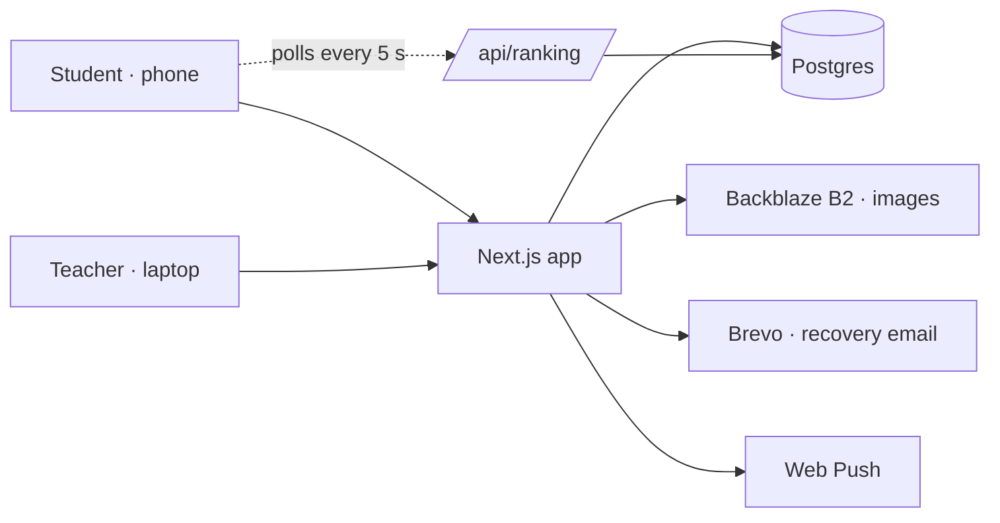

# KREA

> A grades portal for a high school's creative program: students open each grade and see how every question was scored, follow their team and a live ranking; teachers build tasks, grade submissions and adjust ranking points.

*Portal de notas de la Escuela Creativa de un liceo: cada estudiante ve su nota pregunta a pregunta, su equipo y el ranking en vivo; los profesores crean tareas, evalúan y ajustan puntos.*

[Live site](https://krea.fockus.dev) · In production · 

<!-- Poster of the trailer (demo data): the teacher's grading screen. Pending: docs/showcase/media/poster.jpg -->

## What it does

- A student opens a graded task and sees the score of every question, the teacher's comments and the final grade as a coloured pill with its number.
- A student answers an individual task from the phone, with text, links or images; a submission made without connection waits in a queue and is sent when the connection returns.
- A team splits a group task into parts: each member answers theirs, and only the captain sends the team's submission.
- A student follows the ranking of their section, by student and by team, which reorders itself while the teachers grade; the top three stand on a podium.
- A teacher builds a task as a form whose questions add up to exactly 20 points, publishes it to one or more sections and can reopen it for some students.
- A teacher grades a submission in steps of 0.5 per question, with keyboard shortcuts, and sees when another teacher has the same submission open.
- A teacher adds or removes ranking points for a student or a team, always with a reason; those points never change the grade.

## How it is built

| Layer | Choice |
|---|---|
| Framework | Next.js 16 (App Router), React 19, strict TypeScript |
| UI | Tailwind CSS 4, shadcn/ui on Radix; four accent colours and light/dark theme chosen by each user |
| Data | Postgres with Drizzle ORM; migrations in `drizzle/` |
| Auth | Better Auth inside the app; sign-in with the national ID number, no public sign-up (teachers create the accounts) |
| Files | Backblaze B2 through its S3 API: private bucket, short-lived signed URLs |
| Email | Brevo transactional API (password recovery only) |
| Notifications | Web Push (VAPID) when a task is published; installable as a PWA |
| Hosting | Docker container on a VPS, one preview per pull request (`deploy/README.md`) |
| Tooling | Bun, Biome, GitHub Actions |



## Decisions worth noting

**Ranking points are separate from the grade.**
Teachers wanted behaviour (an absence, outstanding participation) to count, but not to touch an academic grade. Each grade of 10 or more contributes its own value to the ranking and a lower one contributes 0; adjustments move only ranking points and always carry a reason. The cost is two numbers per student that the interface has to keep apart and explain on every screen where both appear.

**The live ranking polls every 5 seconds instead of holding a connection open.**
The first version used Firestore listeners. After moving to Postgres, server-sent events were ruled out: long-lived connections on the serverless hosting the app had then, and more code for a list that changes a few times per class. The browser asks `/api/ranking/[seccion]` every 5 seconds and the server answers `204` when nothing changed. The cost is a delay of up to 5 seconds, and requests that keep coming while the tab is open.

**Firebase was replaced by Postgres and Better Auth without migrating the data.**
The project started on Firestore and Firebase Auth and moved to a single Postgres. Only the teachers' accounts were carried over: their Firebase scrypt hashes are imported as they are, verified with Firebase's parameters, and rewritten in Better Auth's format the next time the password changes. Firestore's security rules became server code: the browser no longer reads the database, and every write that recalculates a ranking takes that section's row lock. The cost was rewriting the whole data layer and its tests, and the student data had to be loaded again.

**The repository's seed is anonymous.**
`data/seed/` is a copy of the school's spreadsheet in which every name and ID number was replaced by a fictitious one, consistently across demo data, tests and design canvases. The real data lives outside git in `data/privado/` and only the production import scripts read it. The cost is two data sets to keep in step.

## Quality

- 2291 tests in 162 files (`bun run test`): pure logic in `tests/unit`, and the data layer in `tests/db` against PGlite, an in-process Postgres, so CI needs no database service.
- CI on every pull request: typecheck, lint, the full test suite and the production build.
- Accessibility target WCAG 2.1 AA. `scripts/qa/texto-200.mjs` checks every route at 200 % text size; animations use only `transform` and `opacity` and are replaced by text announcements under reduced motion.
- Every design decision is recorded as one file in `context/decisions/`.

## Run it locally

Requirements: [Bun](https://bun.sh), Node 23.6 or later, and Docker.

```bash
bun install
```

Create `.env.test.local` with the two demo accounts. The "email" is an ID number from the anonymous seed (`.env.example` lists one of each role); the passwords are any value you choose, for local use only:

```bash
ESTUDIANTE_EMAIL_TEST=
ESTUDIANTE_PASSWORD_TEST=
PROFESOR_EMAIL_TEST=
PROFESOR_PASSWORD_TEST=
```

Then start a local Postgres in Docker, apply the migrations, load the seed and start the server:

```bash
bun run qa:local -- --port 4301 --postgres
```

Open `http://localhost:4301/ingresar` and sign in with either account. Nothing here touches a real database.

```bash
bun run typecheck
bun run lint
bun run test
```

## Project structure

| Folder | What it holds |
|---|---|
| `app/` | Routes: `(auth)`, `(estudiante)`, `(profesor)`, the API routes and the internal galleries |
| `components/` | UI primitives and the product's own components |
| `lib/` | Domain logic (grades, ranking, teams, submissions), data access and server actions |
| `drizzle/` | SQL migrations |
| `data/seed/` | Anonymous demo data |
| `tests/` | `unit` and `db` suites |
| `scripts/` | Seed, imports, local QA server and QA checks |
| `deploy/` | How the site is published |
| `context/` | Project context, design rules and decisions |
| `design/` | Design handoff and prototype |

## My role

Full development.
